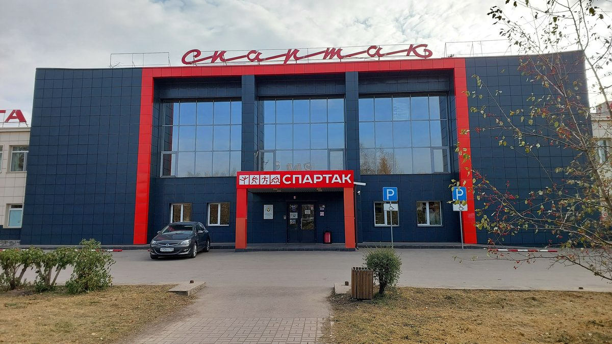

# Дом спорта «Спартак» — сайт

Одностраничный сайт в одном файле: **index.html**.
Откройте его двойным кликом в любом браузере — всё работает без установки.

## Что уже есть на сайте

- **Главный экран** — название, «работаем с 1985 года», кнопки записи, ключевые цифры.
- **Блок «О нас»** — короткое описание: история, кто занимается.
- **Промо-строка** — скидка 50% на пробное занятие и 10% на абонемент в день пробного урока.
- **6 карточек направлений** — бокс, акробатика «Acrosport», самбо/дзюдо, раннее развитие (1–3, 4–6), фитнес «Анастасия», аренда залов и мероприятия. Кнопка «Записаться» в карточке сама подставляет секцию в форму.
- **Цены** — таблица: разовое / абонемент 8 / абонемент 12 / индивидуальная.
- **Инфраструктура** — залы, парковка, пандус, раздевалки, душевые.
- **Фотогалерея** — 6 фото самого здания (из Яндекс.Карт, PastVu и городских СМИ; лежат в папке `images/`).
- **FAQ** — возраст, страховка, парковка, оплата, запись.
- **Форма онлайн-записи** — имя, телефон, секция, возраст, комментарий.
- **Контакты** — адрес, все телефоны, часы работы, оплата, ВКонтакте, Яндекс.Карты с точкой на пр. им. газеты «Красноярский Рабочий», 145.
- Адаптивная вёрстка: корректно смотрится на телефонах, планшетах и компьютерах.

## Что нужно поменять перед публикацией

1. **Цены.** В `index.html` найдите комментарий `<!-- ЗАМЕНИТЕ ЦИФРЫ В ТАБЛИЦЕ... -->` (секция «Цены») и впишите актуальные цены. Сейчас стоят ориентировочные значения.
2. **Фото.** В галерее — фото здания из открытых карточек организации (Яндекс.Карты, PastVu, городские СМИ). Если есть свои фотографии зала и здания — положите 6 штук в папку `images` (`photo1.jpg` … `photo6.jpg`, шириной ~1200 px) — они подставятся автоматически:
   ```html
   
   ```
3. **Ссылка ВКонтакте.** Найдите два комментария `<!-- ЗАМЕНИТЕ ССЫЛКУ... -->` (в контактах и в футере) и поставьте точный адрес группы, например `https://vk.com/...`.
4. **Подсказка по парковке** (FAQ, вопрос «Как добраться до парковки?») — можно дополнить конкретным маршрутом, если он известен.

## Подключить отправку заявок (по желанию)

Сейчас форма показывает сообщение «Заявка отправлена», но данные никуда не уходят. Варианты подключения:

- **Самый простой:** сервисы-облачки форм (Formspree, WebAppForms) — в форму вставляется адрес, заявки приходят на почту.
- **В Telegram:** маленький Telegram-бот, который принимает данные формы и присылает их администратору.
- **Файл формы на хостинге:** если сайт будет жить на хостинге, добавляется скрипт приёма (PHP/Node).

Могу помочь подключить любой из вариантов — скажите, куда должны приходить заявки (почта / Telegram).

## Как выложить сайт в интернет

1. Зарегистрируйте домен (например, `spartak-sport.ru`) — у Reg.ru, beget, Timeweb.
2. Загрузите `index.html` (и папку `images`) на хостинг — beget, Timeweb, REG.RU. Есть бесплатные варианты: Netlify, GitHub Pages — перетаскиваете файлы, получаете ссылку.
3. При желании подключите домен к Яндекс.Картам/2ГИС, чтобы сайт был виден в карточке организации.

## Структура файла

Всё в одном `index.html`: стили (секция `<style>`), контент (HTML), скрипты (в конце файла, `<script>`). Никаких баз данных и внешних зависимостей, кроме шрифта Montserrat и Яндекс.Карт (карта не подгрузится без интернета — остальной сайт работает офлайн).
